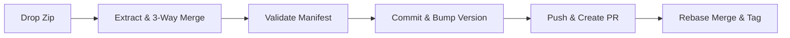

<div align="center">
   
   <p>
     <strong>A git-only delivery pipeline that merges AI patches into pull requests in under 30 seconds.</strong><br/>
     <code>ship</code> automates the commit, push, and release ceremony. Drop a zip file from your AI coding agent, and it handles 3-way merges, conventional commits, and PR creation with zero CI waits. Built for Rust and Node monorepos that demand resilient git safety and parallel execution.
   </p>
   <p>
     <a href="https://github.com/elcoosp/ship/actions"></a>
     <a href="https://crates.io/crates/ship"></a>
     <a href="LICENSE"></a>
     
   </p>
   <p>
     <a href="#quickstart">Quickstart</a> •
     <a href="#features">Features</a> •
     <a href="#the-manifest">Manifest</a> •
     <a href="#workflow">Workflow</a>
   </p>
 </div>

## Demo

```text
  ⚓  s h i p
     git-only delivery pipeline

  watching      /Users/adm/Downloads
  repos root    /Users/adm/Documents/Repos
  projects      186  (MetaCodable, NexusStratum, Rex, aeolus, alacer, …)

  ready.  drop a {project}-{slug}.zip to ship.

  ──────────────────────────────────────────────────────────────────
[catheo]     📦 catheo-v061-truth-sweep-and-hatch-demo.zip
[catheo]     · 3-way merge enabled (base: a1b2c3d)
[catheo]     ✓ [ 1/8]  fix(docs): the README carries the ui-count truth
[catheo]     ✓ [ 2/8]  feat(parser): the entry vocabulary names every spelling
[peregrine]  📦 peregrine-arm64e-auth-producer.zip
[peregrine]  ✓ [ 1/8]  feat(core): the arm64e producer plans auth words

⠋ [catheo]      fetching origin...
⠙ [peregrine]  committing [ 3/8]...
```

## Quickstart

Requires Rust 1.75+ and the GitHub CLI (`gh`).

```bash
cargo install --path .
ship watch
```

Drop a zip named `project-slug.zip` into `~/Downloads`. `ship` takes over from there.

## Features

- **Declarative manifests**: Define commits, version bumps, and PR bodies in a simple `ship.toml` file.
- **3-way merge safety**: Automatically merges AI patches with your concurrent pushes using the `base_commit` recorded in the manifest.
- **Parallel execution**: Process multiple zip drops concurrently with a clean, live `indicatif` dashboard.
- **Resilient git safety**: Stashes WIP, auto-heals stale locks, reverts spurious chmod changes, and validates the tree before touching history.
- **Native integrations**: Sends clickable macOS notifications and generates changelogs via `git-cliff`.

## Workflow



1. **Extraction**: `ship` extracts the zip and strips any wrapper folders.
2. **3-Way Merge**: Applies the zip's changes on top of the `base_commit`, then merges the result into the latest `main`. Concurrent pushes are preserved automatically.
3. **Validation**: Verifies `ship.toml` covers every dirty file (the union check).
4. **Commits**: Creates conventional commits from the `[[commit]]` groups.
5. **Release**: Bumps `Cargo.toml`, `Cargo.lock`, and `package.json` using `cargo set-version`.
6. **Changelog**: Runs `git-cliff` and prepends the release notes.
7. **Push & PR**: Pushes the branch and opens the PR from `.github/pr-body.md`.
8. **Merge & Tag**: Merges via rebase (`gh pr merge --admin`), syncs `main`, verifies the author email, and tags the merge SHA.

## The Manifest

The AI generates a `ship.toml` alongside its changes.

```toml
[delivery]
branch      = "feat/compile-seam"
pr_title    = "feat(compile): the lex-registry-IR seam"
pr_body     = ".github/pr-body.md"
base_commit = "a1b2c3d4e5f6..." # The HEAD commit the AI cloned

[[commit]]
message = "feat(compile): wire the lex-registry-IR compile seam"
files   = ["Cargo.toml", "crates/aeolus-compile/**/*.rs"]

[[commit]]
message = "docs: align the surface to the P2 seam"
files   = ["README.md", "CHANGELOG.md"]
```

> **Auto Per-File Mode:** If you omit the `[[commit]]` blocks entirely, `ship` will automatically generate one commit per dirty file using the message `chore: update <path>`. The `[delivery]` section is still required.

## Safety and Recovery

> [!IMPORTANT]
> `ship` is designed to never destroy work. It uses `git switch -C` and stash-pop to sync, preserving any WIP. Pushing uses `--force-with-lease` to prevent overwriting remote changes, and it refuses to run if your local `main` is ahead of `origin/main` or if the working tree is unexpectedly dirty.

If something goes wrong, `ship` prints a diagnostic panel with the exact commands to fix it:

```text
  ✗ ship failed   aeolus-p2-compile-seam.zip

  ╭─ why ──────────────────────────────────────────────────────────────╮
  │  .github/pr-body.md is TRACKED (in git's index).                   │
  │  .gitignore only applies to untracked files, so adding a pattern   │
  │  does NOT help here.                                               │
  ╰────────────────────────────────────────────────────────────────────╯

  ╭─ fix ──────────────────────────────────────────────────────────────╮
  │  $ cd ~/Documents/Repos/aeolus                                     │
  │  $ git rm --cached .github/pr-body.md  # and/or: ship.toml         │
  │  $ mv ~/Downloads/.failed/aeolus-p2-compile-seam.zip ~/Downloads/  │
  │  $ ship watch --once                                               │
  ╰────────────────────────────────────────────────────────────────────╯
```

## Status

> [!NOTE]
> Stable for daily use. Supports macOS natively (with `terminal-notifier` or AppleScript fallback). Requires a clean git environment and the GitHub CLI for PR merging.
